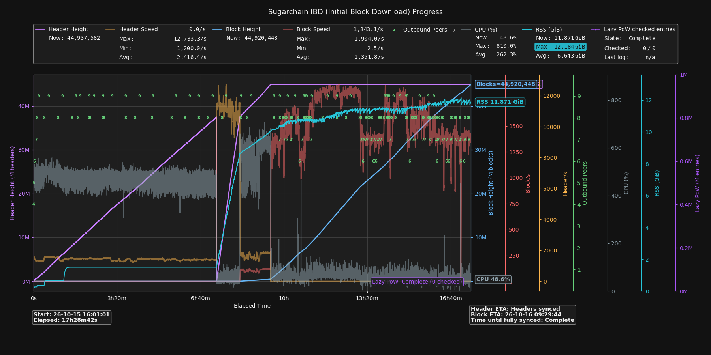
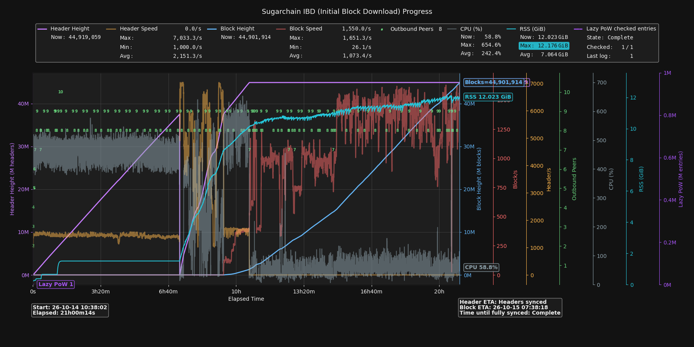

# Completed mainnet IBD comparison: October 14 and October 15 starts

## Observed result

The latest mainnet run exited IBD on **2026-10-16 at 09:29:40 +09:00**; the first sampled equal block/header heights occurred at **09:30:23**. From the first presync progress log to IBD exit, elapsed time decreased from **21h00m10s to 17h29m38s**, saving **3h30m32s (16.71%)**.

These are two observational runs on different dates, not a randomized same-network A/B experiment. Peer supply, host load, chain tip and binaries differ. The four resource/concurrency settings were identical in both startup logs, along with `-fast-startup=1`:

```text
-parpow=8 -maxpowcache=2048 -maxibdblocksinflight=128 -dbcache=4096
```

The current implementation uses internal IBD lookahead 4096 without a new option. This comparison does not isolate that change from the other retained changes or environmental effects. Do not attribute the whole observed gain to one commit.

## Completed graph supplied by the user





The latest graph starts at 2026-10-15 16:01:01 and ends at its last sample, 2026-10-16 09:29:43: **17h28m42s**. The previous graph reports **21h00m14s** from a different monitoring start. These graph durations use different boundaries from the consistent first-presync-log → IBD-exit comparison below. Do not combine a graph duration with a log duration to calculate a reduction.

At the latest graph sample, block height was 44,920,448 and header height was 44,937,582. Its Complete label reflects IBD-flag exit, not exact tip equality. Lazy PoW Complete (0 checked) is a fresh-IBD/no-background-work result, not evidence of another full historical background pass.

## Phase comparison and review priority

Ratings follow the user's scale: 3 = strongly favorable, 2 = very good, 1 = good, 0 = no useful improvement. They are a descriptive assessment of these runs, not a universal adoption guarantee or security rating.

| Rating | Interval | Previous | Current | Time change |
|---|---|---:|---:|---:|
| 2 | Total: first presync log → IBD exit | 21h00m10s | 17h29m38s | 16.71% shorter; 3h30m32s saved |
| 0 | Presync: first presync log → first replay log | 7h13m31s | 7h19m43s | 1.43% longer; 6m12s added |
| 3 | Replay start → first positive block-height RPC sample | 2h09m12s | 55m41s | 56.90% shorter; 1h13m31s saved |
| 1 | First positive block sample → common header height 44,900,000 | 1h16m12s | 1h13m34s | 3.46% shorter; 2m38s saved |
| 2 | Common header height 44,900,000 → IBD exit | 10h21m15s | 8h00m40s | 22.63% shorter; 2h20m35s saved |

The **56.90% result is not the entire replay phase**: replay continues while block processing overlaps. The largest relative reduction is in the pre-first-block replay interval, while the largest absolute saving is after the common header-height boundary. Header height 44,900,000 is a common comparison threshold, not a claim that all header activity stopped there. RPC boundaries have approximately five-second sampling resolution.

Presync did not get faster in this pair. Prior component-only arithmetic benchmarks must not be presented as a measured whole-presync improvement. The much larger synthetic download speedups also must not replace the observed mainnet numbers.

## CPU and RSS costs

Window: each run's first presync log through IBD exit, excluding continued steady-state operation afterward. CPU 100% means one logical CPU. Average CPU is weighted by sample interval; total CPU core-hours are estimated by integrating the sampled percentages, not by a direct process-lifetime CPU counter. Mean RSS is the arithmetic mean of roughly five-second samples; peak RSS uses the process high-water-mark column.

| Rating | Metric | Previous | Current | Interpretation |
|---|---|---:|---:|---|
| 2 | Estimated CPU core-hours | 50.89 | 45.89 | 9.84% lower |
| 0 | Mean process CPU utilization | 242.45% | 262.43% | +19.99 percentage points; more concentrated CPU use |
| 0 | Maximum sampled CPU utilization | 654.61% | 810.00% | Higher sampled burst; not a bound on unseen peaks |
| 0 | Process peak RSS | 12.176 GiB | 12.184 GiB | +8.20 MiB, +0.066%; effectively unchanged at this scale |
| 1 | Mean RSS across the interval | 7.065 GiB | 6.640 GiB | 6.01% lower, affected by phase durations |

Shorter total CPU consumption and higher utilization are compatible because execution finished sooner. Lower whole-run mean RSS does not establish a separate memory-allocation improvement. The older and newer graph averages (242.4%/262.3% CPU, 7.064/6.643 GiB RSS) use the graph's different sampling window and arithmetic averaging; they need not equal this table exactly. No further peak-RSS reduction is demonstrated by this pair.

## Event boundaries (+09:00)

| Event | Previous | Current |
|---|---|---|
| First presync progress log | Oct 14 10:38:03 | Oct 15 16:00:02 |
| First replay progress log | Oct 14 17:51:34 | Oct 15 23:19:45 |
| First positive block-height RPC sample | Oct 14 20:00:46 | Oct 16 00:15:26 |
| First RPC sample with headers ≥44,900,000 | Oct 14 21:16:58 | Oct 16 01:29:00 |
| IBD exit log | Oct 15 07:38:13 | Oct 16 09:29:40 |
| First sampled equal heights near tip | Oct 15 07:38:51 | Oct 16 09:30:23 |

Sources are the user's preserved previous/current debug logs, resource_metrics.csv and ibd_rpc.csv; only derived aggregates and the explicitly supplied completed graph are published. See [machine-readable aggregates](benchmarks/ibd-mainnet-2026-10-16-summary.json). The phase intervals sum exactly to each log-based total. Raw logs, credentials, live snapshots and operating settings are not uploaded or changed.

## Relation to isolated tests and PR organization

Keep the [16-run isolated internal-window comparison](ibd-download-window.md#no-option-comparison) as controlled fixture evidence; the mainnet pair above is separate observational evidence. The earlier claim that mainnet has not been rerun is superseded by this report, but controlled per-feature mainnet attribution, HDD/pruning/reindex comparisons and a presync speedup remain unproven.

Keep the planned later Lazy PoW / RSS management / presync split and classify the separate block-download performance work before splitting. No split, merge, runtime change, new benchmark workload or node restart was performed to write this report.
